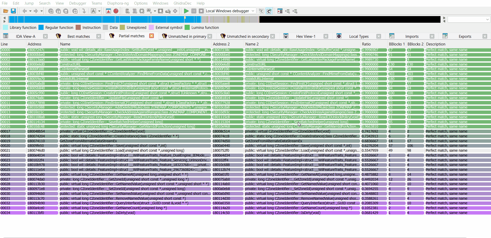
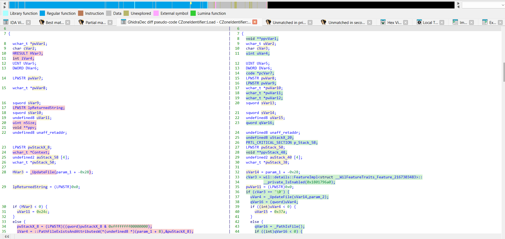
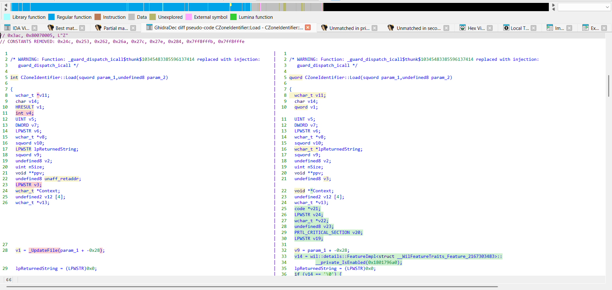
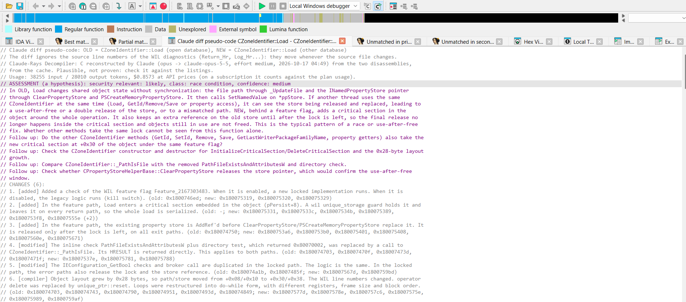

# Diaphora-ng for IDA Free/Pro

[Diaphora](https://github.com/joxeankoret/diaphora), the program diffing tool by Joxean Koret, ported to the IDA C++ SDK for IDA Free/Pro 9.4+, **plus the pseudo-code diffs that IDA Free cannot have otherwise**:

- **Claude diff pseudo-code:** [Claude-Rays Decompiler for IDA Free/Pro](https://github.com/Claude-Rays/claude-rays-decompiler-idafree) decompiles both versions of a match in a single query, aligned so that only the real changes stand out, lists the changes and assesses whether the patch fixes a security bug.
- **GhidraDec diff pseudo-code:** [GhidraDec](https://github.com/Claude-Rays/ghidradec-idafree) decompiles both versions with Ghidra's decompiler, locally and for free, and aligns them with the locals named the same on both sides.

Everything else is [diaphora-idafree](https://github.com/Claude-Rays/diaphora-idafree): the port is based on Diaphora 3.4.1, commit [`de0eb92`](https://github.com/joxeankoret/diaphora/tree/de0eb920c1e54649bb3e7c4df5fa058b5c2cdc91) of the original repository, and its SQLite database schema (version 3.4) and SQL heuristics are those of the Python version.

*Claude diff pseudo-code* and *GhidraDec diff pseudo-code* on a patched function of urlmon.dll, `CZoneIdentifier::Load` (September vs October 2026):



> **Note:** So far the plugin has only been tested on Windows, with IDA Free 9.4 and x64 PE binaries. It is a native plugin built with the current SDK, so it should work in IDA Pro too.

> **Why pseudo-code diffs need help in IDA Free:** IDA Free's cloud decompiler gives plugins no access to the decompiler API, so Diaphora can only export and diff assembly there. The two diffs of Diaphora-ng get the pseudo-code from other plugins instead, when you open a match, without exporting anything in advance. IDA Pro with a local Hex-Rays decompiler has not been tested.

## Requirements

- IDA Free/Pro 9.4+ on Windows.
- For *GhidraDec diff pseudo-code*: [GhidraDec](https://github.com/Claude-Rays/ghidradec-idafree) (`ghidradec.dll`, API version 3) in the IDA plugins folder, and the Ghidra installation it needs. The binary of the other version must still be on disk (see below).
- For *Claude diff pseudo-code*: [Claude-Rays Decompiler for IDA Free/Pro](https://github.com/Claude-Rays/claude-rays-decompiler-idafree) (`clauderays-decompiler.dll`, API version 1) in the IDA plugins folder, with the [Claude Code](https://claude.com/claude-code) CLI installed and logged in.

Both are optional: Diaphora-ng finds them at run time (and loads them if needed), and without them the commands say what is missing.

## Build

Requirements (Windows):

- Visual Studio 2022 with the *Desktop development with C++* workload
- CMake ≥ 3.25 and Ninja (both ship with Visual Studio)
- The IDA SDK matching your IDA version (e.g. [HexRaysSA/ida-sdk](https://github.com/HexRaysSA/ida-sdk)), with the `IDASDK` environment variable pointing to it

```bat
set IDASDK=C:\path\to\ida-sdk
build.bat          :: incremental build
build.bat clean    :: build from scratch
```

`build.bat` loads the VS 2022 Developer Command Prompt (x64) and runs CMake + Ninja. The plugin ends up in `bin\diaphora-ng.dll`, linked with the static CRT (`/MT`), so it does not need the VC++ redistributable.

SQLite: by default the plugin links against `winsqlite3.dll`, which ships with Windows 10/11, so there is nothing else to install. If you'd rather embed SQLite, drop `sqlite3.c` and `sqlite3.h` (the amalgamation) into `third_party/sqlite/` and rebuild.

## Install

Copy `diaphora-ng.dll` (and, for the pseudo-code diffs, `ghidradec.dll` and `clauderays-decompiler.dll`) to the `plugins` folder of your IDA installation (e.g. `C:\Program Files\IDA Free 9.4\plugins\`, needs admin) or to `%APPDATA%\Hex-Rays\IDA Pro\plugins\`.

Diaphora-ng can be installed next to diaphora-idafree: it has its own DLL, plugin name (*Edit > Plugins > Diaphora-ng*), top-level menu (**Diaphora-ng**), action names and log prefix. Both register `F3` (*Show results*) and `Ctrl+Alt+I` (*Import selected*), so with both installed IDA reports the conflict and only one plugin gets each shortcut; and their result choosers have the same titles, so do not open results in both at the same time.

## Usage

Everything is under the top-level **Diaphora-ng** menu:

| Entry | What it does |
|---|---|
| Diff or export | Export dialog (same options as the original). Exports the IDB to SQLite and, if a second database is selected, diffs them |
| Show results (F3) | Reopens the result choosers |
| Load results / Save results | `.diaphora` files |
| Load and import results | Loads a `.diaphora` file and imports every `sub_*` match from the best and partial choosers |
| Import definitions | Imports TILs, structs, unions and enums from an exported database |
| Local diff | Diffs two functions of the current database (`extras/diaphora_local.py`) |
| Toggle dark mode colors | Switches the background colors of the diff viewers |
| GhidraDec diff settings... | The two optional phases of the GhidraDec diff (see below) |

Typical workflow: export binary A to `A.sqlite`, open binary B, and in *Diff or export* pick `B.sqlite` as output and `A.sqlite` as the database to diff against.

Result choosers (*Best*, *Partial*, *Unreliable*, *Problematic*, *Unmatched in primary/secondary*, *Interesting matches*) have the original right-click menu (diff assembly / microcode / pseudo-code, side by side or as a patch, graph diffs, callers/callees graph, external tool, manual match, diff again, import selected / all, highlight), plus the commands of Diaphora-ng:

| Command | What it does |
|---|---|
| GhidraDec diff pseudo-code | Side-by-side diff of both versions decompiled by Ghidra: OLD on the left, NEW on the right |
| GhidraDec pseudo-code patch | The same as a unified diff |
| Claude diff pseudo-code | Side-by-side diff of both versions decompiled by Claude, with the changes and a security assessment |
| Claude pseudo-code patch | The same as a unified diff |
| Regenerate Claude diff | Asks Claude again, ignoring the cache |
| Set the new version for Claude/GhidraDec... | Asks again which database is the new version |

**Orientation:** Diaphora does not know which version is the patched one. The first Claude or GhidraDec command on a set of results asks whether the open database is the NEW version. The answer is kept until the results are closed or reloaded.

### GhidraDec diff pseudo-code

Deterministic, local and free: nothing leaves the machine, and a diff takes a second or two.

- **Live, both versions.** Nothing is exported in advance. When you open a diff, GhidraDec decompiles the function of the open database from the IDB, and the one of the other version from its **binary** on disk (PE or ELF, mapped at the image base of the other database), with the processor, the compiler spec and the options of the open database. Ghidra needs the bytes, and the SQLite export has none, hence the binary. The names and prototypes of the function and of its callees come from the other database's export; the prototypes of the imports, from the import of the same name in the open database. GhidraDec keeps the loaded binary and its `decompile.exe` between calls, so only the first diff pays the loading.
- **Finding the binary:** the export stores the input file path in `program_data` (`type = 'input_file'`, `name = 'path'`). If that file is still there and its MD5 is the one in the database, it is used. Otherwise (an export of another Diaphora, or the file was moved) Diaphora-ng asks for it once per session; a file with another MD5 needs a confirmation. The chosen path is written back into the other database for the next sessions.
- **The names of the locals.** Ghidra names locals after registers and stack offsets (`uVar3`, `local_28`), so two builds of the same function get different names and the diff is mostly noise. Two optional phases fix that, both on by default (*Diaphora-ng > GhidraDec diff settings...*; registry `diaphora_ghidradec_canonical_names` and `diaphora_ghidradec_rename_locals`):
  - **Level 1, canonical names:** the locals are named `v1`, `v2`... on both sides in the order of first use, as Hex-Rays does.
  - **Level 2, NEW renamed after OLD:** the locals of NEW take the names of the locals of OLD they match, by where they are used, so the same variable has the same name on both sides and a real change of variable is a changed line.

  With both off, the diff shows what Ghidra's decompiler gives, so you can see what the two phases gain. The header of the view says which ones were applied.

  The same diff with both phases off: the locals have different names on each side (`pwVar1` / `ppvVar1`, `HVar3` / `cVar3`...), so most declarations are marked as changed:

  

  With both phases on: the locals are `v1`, `v2`... and have the same names on both sides, so only the new locals and the new code (the WIL feature flag and the critical section) are marked:

  
- **What the diff ignores**, so it does not mark it: addresses (`sub_180012340`, `DAT_...`, `LAB_...`, numbers that point into the image, also inside comments), the source line numbers of the WIL diagnostics (the number before a `"file.cxx"` argument), and indentation and spacing. Those lines are shown with their real text; the header counts them.
- **The header:** the orientation and where each version comes from, the Ghidra folder and time, then the **changes** (each run of changed lines with the calls and constants it adds or removes) and the calls and constants added or removed in the whole function.
- The other side has fewer names than the open one: the binary has no IDA types for globals and no local variable names, so a few more lines may differ only in their casts or `DAT_` names.

### Claude diff pseudo-code

Both versions decompiled by Claude in one query, aligned, with the changes and a security assessment. It costs a query (see below), and it is cached in the open database.



- **What is sent:**
  - The open database's version: only its address. Claude-Rays Decompiler collects its full context from IDA (frame, types, data, call sites, instruction facts).
  - The other version: built from its SQLite export: its basic blocks with instructions, comments and successors, the called functions, the constants, the prototype and the comment. If that database was exported with *function summaries only*, there are no blocks; its plain assembly is sent instead, and the view says so.
  - The diff of the cleaned assembly (`clean_assembly`, no addresses): it tells the model what really changed.
- **The view:** the header shows the model, effort, usage and cost, then the security **assessment** (a hypothesis: class, reasoning, confidence, what to check next) and the list of **changes** with their addresses in each version, then the validator warnings, the uncertain spots and the two summaries. The code is shown without the address annotations (addresses differ between versions, so every line would differ), and the source line numbers of the WIL diagnostics are ignored when comparing. The original *Diff pseudo-code* is untouched.
- **Cache:** the answer is stored in the open database (netnode `$ clauderays diff`) under the function, with the other version's hash and the orientation. Opening the same pair again costs nothing; *Regenerate Claude diff* asks again.
- **Cost:** one query per pair, with the model and effort set in Claude-Rays Decompiler; on a subscription it counts against the plan's usage. A real pair of urlmon.dll, `CZoneIdentifier::Load` (a fix behind a WIL feature flag, which keeps both the old and the new body), took 38015 input / 23778 output tokens with Opus 5.5 medium, $0.78 at API prices. The assessment was "likely, race condition, confidence medium", with follow-ups to check the other accessors and the constructor for the same lock.
- **Privacy:** the disassembly of both versions leaves your machine and goes to Anthropic through the Claude Code CLI.

Limits: the other version has less context (no stack frame, types, data or call sites), and only one cached Claude diff is kept per function of the open database: comparing the same function with another match replaces it.

### Batch modes (environment variables)

| Variables | Effect |
|---|---|
| `DIAPHORA_AUTO=1`, `DIAPHORA_EXPORT_FILE=x.sqlite` (optional `DIAPHORA_USE_DECOMPILER`, `DIAPHORA_FROM_ADDRESS`, `DIAPHORA_TO_ADDRESS`) | Export once the database is loaded, then quit |
| `DIAPHORA_AUTO_DIFF=1`, `DIAPHORA_DB1`, `DIAPHORA_DB2`, `DIAPHORA_DIFF_OUT` | Diff two databases, save the results, then quit (the command line mode of `diaphora.py`) |

IDA Free has no `-A` batch mode, so there IDA still shows its usual dialogs (load file, save database). The `DIAPHORA_*` overrides from the original also work: `DIAPHORA_UNRELIABLE`, `DIAPHORA_RELAXED_RATIO`, `DIAPHORA_SLOW_HEURISTICS`, `DIAPHORA_CPU_COUNT`, `DIAPHORA_SQL_TIMEOUT_LIMIT`, `DIAPHORA_MINIMUM_IMPORT_RATIO`, `DIAPHORA_DECOMPILER_PLUGIN`, `DIAPHORA_DEBUG`, …

## Mapping Python → C++

As in [diaphora-idafree](https://github.com/Claude-Rays/diaphora-idafree#mapping-python--c), plus:

| Diaphora-ng | C++ |
|---|---|
| GhidraDec diff pseudo-code: the link to `ghidradec.dll`, the request, the view | `src/ghidradec_link.cpp`, `src/ghidra_diff.cpp`, the commands in `src/ui.cpp` |
| Claude diff pseudo-code: the link to `clauderays-decompiler.dll`, the request built from the SQLite, the view | `src/clauderays_link.cpp`, `src/claude_diff.cpp`, the commands in `src/ui.cpp` |

To regenerate the heuristics from a checkout of the original: `python tools/gen_heuristics.py C:\path\to\diaphora` (by default it looks for `..\diaphora`, next to this repository).

## Differences from the original

- **GhidraDec and Claude diff pseudo-code**: new, see above. The export stores one more `program_data` row, the path of the input file.
- **"Related compilation unit" heuristic** (`find_related_compilation_unit` in `src/differ.cpp`). The original compares every function inside the address range of the matched function's compilation unit. Compilation units found by LFA interleave, so those ranges cover a large part of the binary: in urlmon.dll they cover about 9 times as many functions as the units contain. Without symbols, each query reached the 1M-row limit after about 12 s, the heuristic ran it again for each of the ~4000 matches, and the diff took hours. Now:
  - it compares only the functions that **belong** to each unit (`compilation_unit_functions`);
  - each pair of units is queried once;
  - the timeout covers the whole heuristic, including the time inside each query.

  The cost: functions close in address but in another unit, or in no unit, are no longer found by this heuristic (other heuristics may still find them), so the results can differ from the original's.
- **No Python.** Project-specific Python scripts (hooks) aren't supported. The default patch diffing script (`patch_diff_vulns.py`) is built in and kicks in automatically, like the original, when a patch diffing session is detected.
- **No machine learning model.** The scikit-learn `.pkl` model can't be loaded from C++, so the "Use an already trained model" option and the *ML matches* chooser are gone.
- **UI without Qt.** The IDA C++ SDK does not ship Qt headers, so:
  - HTML diffs are custom viewers, with syntax highlighting through IDA's color tags. As in the HTML of the original, only the changed characters get a background (green added, red deleted, yellow changed), drawn through `ui_get_lines_rendering_info`. The colors are translucent, so they work with both the light and the dark themes.
  - Result choosers: the rows are colored by ratio, as in the original. A row drops its color while it is selected, so that its text stays readable.
  - Graph diffs use native graph viewers, docked side by side and zoomed to fit. Pan and zoom are not synced between the two.
- **MD-Index** is computed in `double`. Python uses `Decimal` with 28 digits, so the text in `md_index` can differ in the last digits from a database exported by the Python version. Diff databases exported with the same version of the plugin.
- **Decompiler:** the plugin tries `init_hexrays_plugin()` and, if that fails, loads `hexrays` or `hexx64`. IDA Free's cloud decompiler (`hexcx64`) gives plugins no access to the decompiler API, so in IDA Free (or without a decompiler) it exports assembly only, and the pseudo-code diffs come from GhidraDec and Claude-Rays Decompiler.
- **No `-A` batch mode in IDA Free**: the export and diff batch modes work, but IDA shows its usual dialogs; the HTML diff mode of the original (`DIAPHORA_AUTO_HTML`) was not ported.
- **No standalone diffing.** `python diaphora.py db1 db2` diffs two databases without IDA. Here diffing runs inside IDA, also from the `DIAPHORA_AUTO_DIFF` batch mode.
- **Configuration at build time.** `diaphora_config.py` is a Python file users can edit; here the values are compiled into `src/config.hpp`. The most useful ones can still be overridden at runtime with `DIAPHORA_*` environment variables.
- Small fixes over the original: pseudo-code comments are saved on export too (the original cleared them before saving), import at instruction level orders the rows by side, and a renamed variable no longer shadows the imported name.

## License

Like the original, this port is released under the GNU AGPL v3; see [LICENSE](LICENSE). The parts ported from third-party code keep their notices in the source headers: kfuzzy (LGPL 2.1), CodeCut's Local Function Affinity (MIT, JHU/APL), Python's difflib (PSF License) and Paul Harrison's Tarjan sort.
